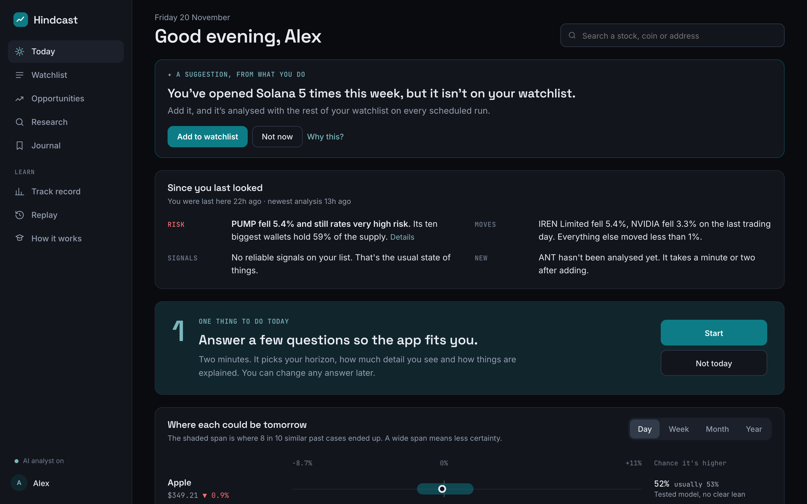
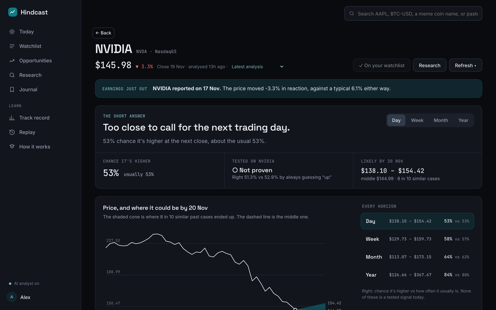
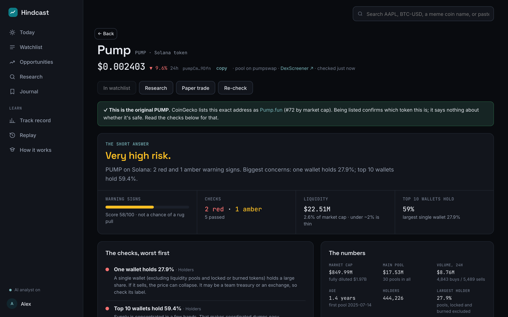
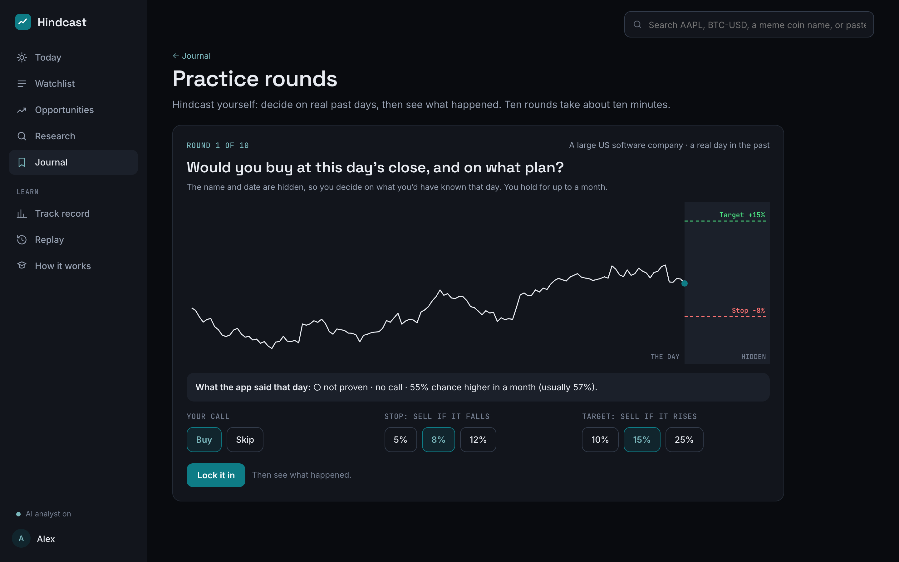
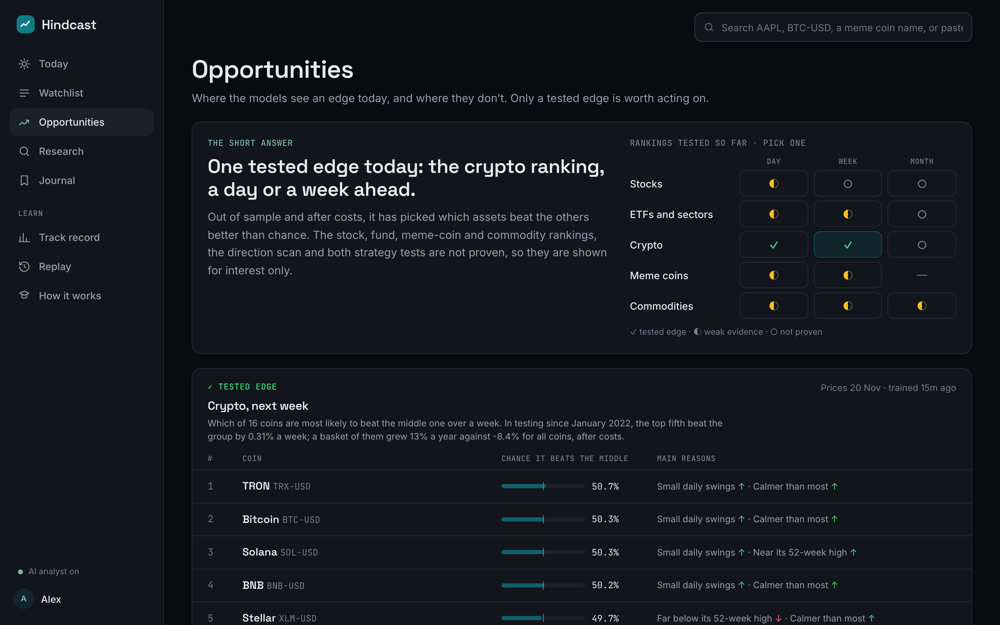
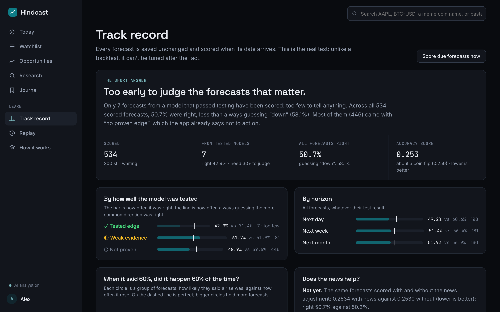
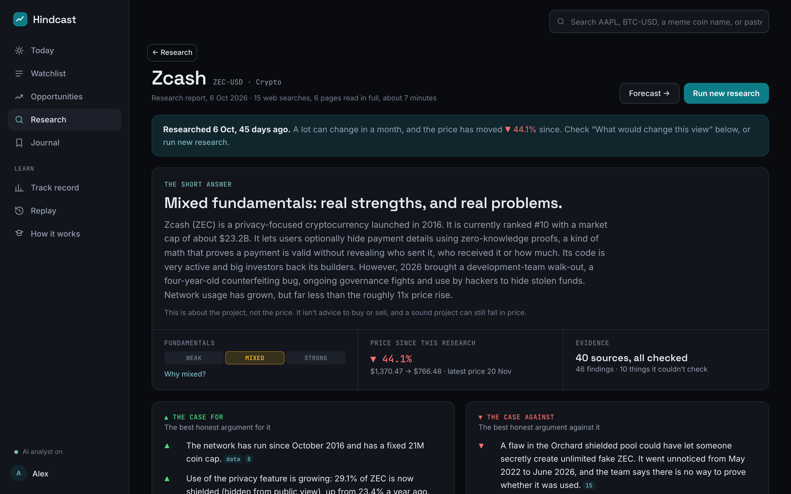

# Hindcast: open-source stock, ETF and crypto forecasts, tested before you trust them

[](LICENSE)


**Hindcast** is a self-hosted, open-source **market forecasting app** for stocks on any exchange, ETFs, indices,
commodities and crypto. It estimates the probability that a price will be higher in **a day, a week, a month and a
year**. Every model is **walk-forward tested against history** (a hindcast) before it may show a signal. When a
forecast is no better than how often the price usually rises, it says so plainly. A coin flip is called a coin flip.

It also runs **meme-coin safety checks** (rug-pull, copycat and holder-concentration risks on Solana, Ethereum and
Base) and writes **sourced AI due-diligence reports** with Claude. There's a **paper-trading journal** and **practice
rounds** on real past days, plus a personal model that learns from your own trades.

> For research and education. Not financial advice.

<!-- Demo video: on GitHub, edit this file and drag the video onto this line to embed it. -->



## Features

- **Probability forecasts with ranges.** Each one shows the chance the price is higher at each horizon, next to how
  often it usually rises, plus the likely price range (10th to 90th percentile).
- **Tested before trusted.** Walk-forward validation with purged training windows. Every signal is marked ✓ tested
  edge, ◐ weak evidence or ○ not proven.
- **An honest track record.** Every forecast is stored unchanged and scored when its time is up, with calibration
  charts and a drift monitor that demotes models doing worse live.
- **Plain-English explanations.** Every forecast is explained, from the drivers and similar past days to the news
  headlines and earnings.
- **Opportunities.** Cross-asset ranking models and a direction scan with a false-discovery correction. Popular
  strategies are backtested before they're shown.
- **Meme-coin and DEX token safety.** Search by name or contract address. It checks for copycats, owner powers in the
  contract, holder concentration, liquidity and whether you could sell.
- **AI research reports.** Claude searches and reads the web and writes a cited report on the fundamentals: team,
  token supply, real activity, roadmap against delivery, and red flags. A monthly budget caps the spend.
- **Paper-trading journal.** Fees are included, and portfolio risk checks and "Worth a look" reminders draw on your
  own record.
- **Practice rounds.** Decide on a real past day with the name and date hidden, then see what happened straight away.
- **Replay.** Go back to any day and see what the app would have said, using only what was known then.
- **Learns from you, and always asks first.** Suggestions come from how you use the app, and each one says why.
  Everything learned is listed and can be paused or forgotten.
- **Multi-user.** Accounts, invites, light and dark themes, beginner-friendly wording, and Telegram alerts.

## Screenshots

| | |
|---|---|
|  |  |
| **Asset page:** the short answer, likely ranges for every horizon, and why | **Meme-coin safety:** is it the real token, and how could you lose money? |
|  |  |
| **Practice rounds:** decide, then see the month that followed | **Opportunities:** only what passed its tests |
|  |  |
| **Track record:** every forecast scored, calibration checked | **Research:** a sourced due-diligence report |

## How it's built

- **Backend:** Go (`backend/`), standard-library HTTP, PostgreSQL (everything is stored there). No ML dependencies:
  ridge logistic regression, k-NN analogs, gradient-boosted trees and HAR volatility models are written in Go.
- **Frontend:** React + TypeScript + Vite (`frontend/`).
- **Data:** Yahoo Finance, Twelve Data, Nasdaq, SEC EDGAR, CoinGecko, DexScreener, GoPlus and GeckoTerminal. Claude
  is optional, for news analysis and research.
- **Why things are built this way, plus the roadmap:** [DECISIONS.md](DECISIONS.md). Read it before trading.
- **How to use it:** [TUTORIAL.md](TUTORIAL.md). New to investing? Start with the step-by-step guide
  [docs/WALKTHROUGH.md](docs/WALKTHROUGH.md) (Apple, Bitcoin and the PUMP meme coin, every number explained).

## Quick start

Requirements: Go 1.26+, Node 20+ and PostgreSQL 14+. The app expects a database called `market_oracle` on
localhost by default (`createdb market_oracle`), or set `DATABASE_URL`. Tables are created automatically.

```bash
cp .env.example .env          # optional: add ANTHROPIC_API_KEY for the AI news analyst
cd frontend && npm install && cd ..
make dev                      # backend :8080 + UI :5173, then open http://localhost:5173
```

Single-binary mode (the Go server also serves the built UI):

```bash
make run                      # open http://localhost:8080
```

On first start the server downloads the earnings history (about an hour, in the background, resumable) and trains the
cross-asset models (a few minutes). You can do both ahead of time:

```bash
cd backend
go run ./cmd/server -backfill   # earnings reports since 2010 from Nasdaq's calendar
go run ./cmd/server -train      # cross-asset direction + ranking models, prints their out-of-sample record
```

Analyse one symbol from the terminal:

```bash
make analyze SYM=NVDA
cd backend && go run ./cmd/server -analyze BTC-USD -no-llm
```

## Accounts

Everyone signs in, and each person has their own watchlist, journal and profile. Forecasts, the track record, rankings,
research reports and token checks are shared, and are the same for everyone.

**First start.** With no accounts yet, the server prints a one-time link in its log:
`no accounts yet: create the admin account at http://localhost:8080/signup?invite=...`. Open it to create the admin
account. That account takes over the watchlist and journal from before accounts existed.

**Inviting people.** Go to *Admin* (in the menu under your initials) and choose *Create invite link*. One link can be shared
with a whole group: choose how many people may use it and for how long. The link is shown once; only a fingerprint of it
is stored. Set `SIGNUP=open` to let anyone join without an invite.

**Who can do what.** Members can use everything for themselves. Only admins can run scans, retrain models, use *Run all
now*, re-run the strategy tests, see Claude spend, receive Telegram alerts, and manage people. Members get a daily
allowance of AI-assisted refreshes (`MEMBER_AI_RUNS_PER_DAY`) and a monthly allowance of research reports
(`MEMBER_RESEARCH_PER_MONTH`). Reading existing reports is unlimited.

**Forgotten passwords.** Set the `SMTP_*` variables and people can reset their password by email. Without email, an
admin makes a one-day reset link on the Admin page and sends it to the person.

**Setup questions.** After signing up, each person answers a few questions (experience, goals, horizon, interests,
reaction to a 30% fall) and a 5-question knowledge check. The answers decide the default horizon, how much detail is
shown, the tips on the watchlist page and the starter watchlist. They never change a forecast, a test result or a
warning. *About you* lists every answer with exactly what it changes, and lets people edit it, download their data,
sign out other devices or delete the account.

**Hosting for others.** Put the server behind HTTPS (for example Caddy or nginx), set `APP_URL=https://your-domain`, which
marks the sign-in cookie Secure, and set `TRUST_PROXY=true` only when a reverse proxy sits in front.

## Today and your look

The home screen (`/`) is **Today**: a short briefing (earnings in the next week, risky tokens, the day's moves, any tested
signals, stale data), **one thing to do today**, and a chart of where each watched asset could be at a chosen horizon
(the shaded span covers 8 in 10 similar past cases). The full watchlist table moved to `/watchlist`.

- The suggestion is chosen by rules in `backend/internal/today` (earnings within two days, depending on whether you hold
  the stock; a very-high-risk token falling 10% or more; a trade without a stop; unfinished setup; one beginner read).
  **Not today** hides it until tomorrow (with Undo); acting on it means it isn't suggested again.
- Each person picks **light / dark / auto** and an **accent colour** on About you. It's saved to the account
  (`PUT /api/account/prefs`) and cached on the device so pages don't flash. Green and red always come with ▲ ▼.
- Fonts (Space Grotesk, Inter, JetBrains Mono) are bundled with the app; no third-party font requests.

## Symbols

Use Yahoo Finance tickers: `AAPL`, `BRK-B`, `VOD.L` (London), `SAP.DE` (Xetra), `7203.T` (Tokyo), `RELIANCE.NS`
(India), `SHOP.TO` (Toronto), `BTC-USD`, `SOL-USD`, `GC=F` (gold), `CL=F` (oil), `^GSPC` (S&P 500). The search box in
the top bar looks symbols up for you, and also finds DEX tokens by name. Paste a Solana address (base58) or an
Ethereum/Base address (`0x…`) to open that token's safety report.

## What runs when

| When | What |
|---|---|
| `RUN_TIMES` (default 07:30 and 19:30 local) | Score due predictions, refresh upcoming earnings dates, retrain the cross-asset models if older than `RETRAIN_AFTER` (20h), re-analyse every watchlist symbol with the AI analyst, then run the direction scan |
| "Run full analysis" on an asset page | Fresh data, full model and AI news analysis for that symbol |
| "Run all now" on the watchlist | The scheduled cycle, on demand |
| Opportunities → Rankings | Cross-asset ranking per universe (stocks, ETFs, crypto, commodities) and horizon, refreshed with each training |
| Opportunities → Direction scan | Each asset's own model across a universe, keeping proven, positive-expectancy signals after a false-discovery correction |
| After each scheduled run | Refresh the drift monitor (demote horizons whose live record is worse than the base rate); if Telegram is configured, send alerts for signal changes, demotions, journal stops and targets, and the circuit-breaker |
| Token page / Journal page | Live: token checks are cached 10 minutes; journal positions are revalued on every load |

Every analysis is saved. Every forecast is stored unchanged and later scored in **Track record**.

## Tests

```bash
make test
```

Key tests: indicators never read future data; the model reports *no edge* on pure random walks and finds a planted
signal; training windows are purged; external market data is lagged correctly; predictions resolve correctly; and the
Claude request and response format is checked against a mock server.

## Layout

```
backend/
  cmd/server/            entrypoint (HTTP server, scheduler, -analyze CLI)
  internal/market/       Yahoo / Twelve Data / Nasdaq / CoinGecko providers, disk cache, benchmarks
  internal/indicators/   causal technical indicators
  internal/features/     ~25 time-aligned model inputs (incl. benchmark, VIX, rates, dollar, crypto F&G)
  internal/model/        ridge logistic regression, k-NN analogs, walk-forward validation, metrics, backtest
  internal/pooled/       cross-asset direction models and cross-sectional ranking models (train, validate, apply)
  internal/earnings/     Nasdaq earnings-calendar history (Postgres), resumable backfill
  internal/news/         RSS collection, finance lexicon, Claude analyst
  internal/engine/       orchestration, explanations, signals, risk plan, scanner, replay
  internal/vol/          HAR volatility forecasts, validated against 63-day volatility
  internal/gbm/          gradient-boosted trees (used in rankings where they beat the linear model)
  internal/token/        DEX token search and safety reports (DexScreener, GoPlus, GeckoTerminal)
  internal/journal/      paper-trading journal and portfolio risk checks
  internal/alert/        Telegram alerts
  internal/research/     on-demand due-diligence reports (Claude + web search, sourced, with memory)
  internal/fundamentals/ point-in-time company financials from SEC EDGAR; "business vs price" pattern and backtest
  internal/levels/       weekly Fibonacci and support levels, entry/stop plan, level test
  internal/strategies/   runs both strategy tests across the point-in-time S&P 500 and today's screen
  internal/store/        PostgreSQL persistence (all tables, incl. price cache and trained models)
  internal/tracker/      live prediction scoring and drift monitor
  internal/scheduler/    twice-daily runs
  internal/api/          JSON API + static UI
frontend/src/
  pages/                 Watchlist, Asset (full reasoning), Token (safety report), Opportunities, Track record,
                         Research, Journal, Replay, How it works
```

## Licence

[MIT](LICENSE). Hindcast is for research and education. It is not financial advice, and past performance in testing does not guarantee future results.
