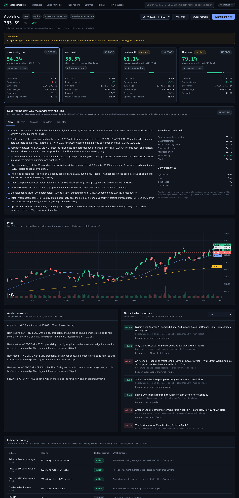
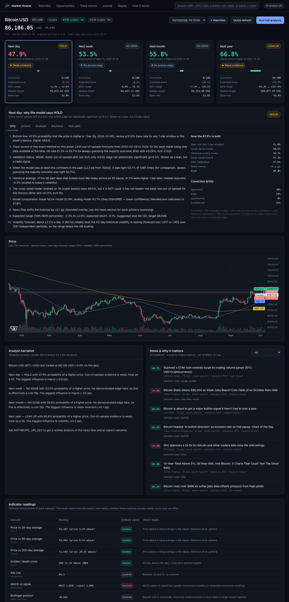
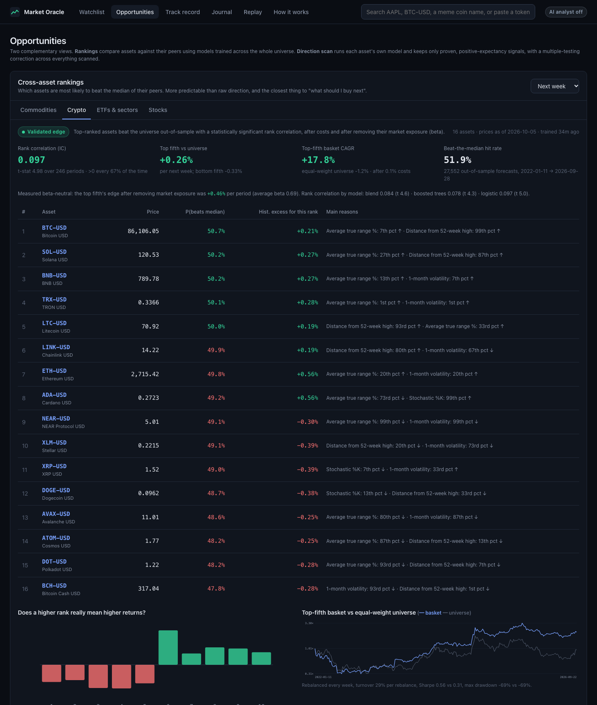
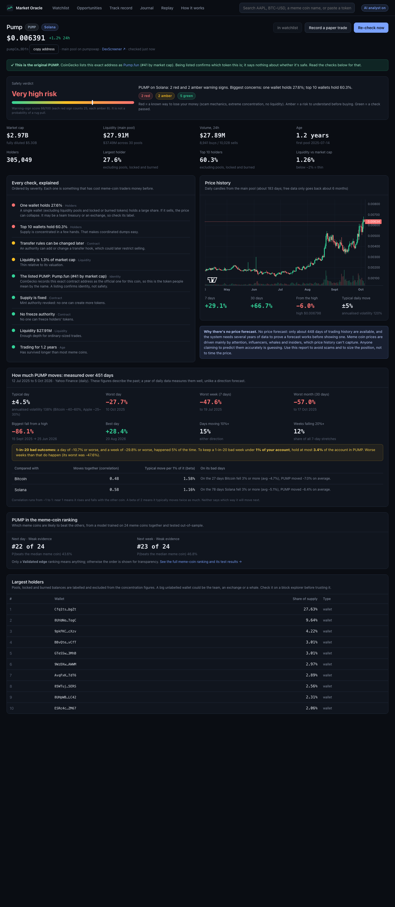
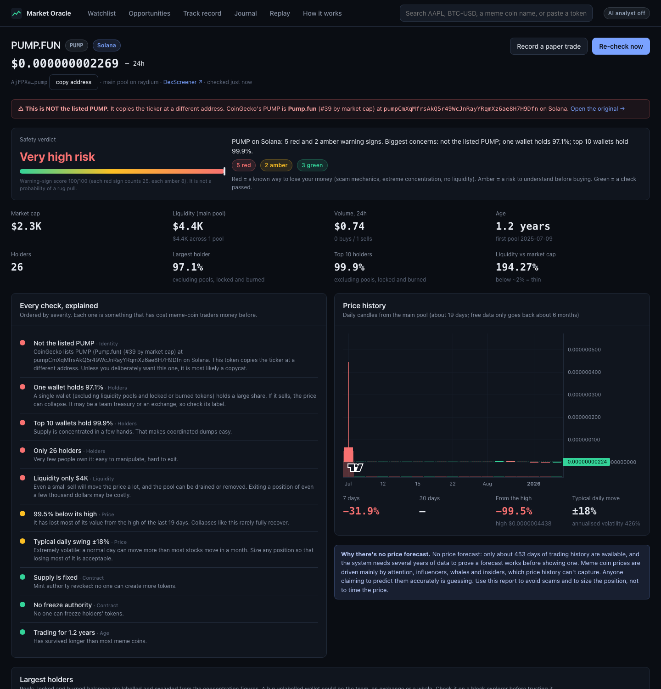
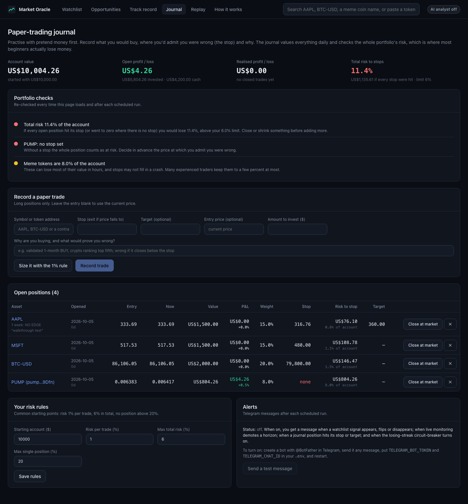

# From zero to a decision: a guided walkthrough

This guide takes three real examples from start to finish and explains every number the platform shows on the way:

1. **Apple (AAPL)**, a large, well-known stock
2. **Bitcoin (BTC-USD)**, the biggest cryptocurrency
3. **PUMP**, the pump.fun meme coin on Solana

It assumes you are new to investing. Every term is explained the first time it appears, and there is a glossary at the
end. All numbers are real outputs from **5 October 2026**. When you run it yourself the numbers will differ, but they
read the same way.

> **Not financial advice.** The platform measures and explains; it doesn't know your finances. The decisions below
> show *how to reason*, not what you should buy.

---

## Part 0. Three facts to accept before you start

1. **Most price moves can't be predicted, and the platform tells you when that's the case.** Each forecast is tested
   on thousands of past situations, using only the data that was available at the time, before it is allowed to
   call itself useful. Most stock and crypto forecasts fail that test and are labelled **NO EDGE**. That label isn't
   a bug. It is the most valuable thing the platform tells you: *"don't trade on a prediction here."*
2. **"60% chance of going up" is not good news by itself.** Many assets rise in most months anyway. What matters is
   whether the forecast differs from the asset's usual rate (the **base rate**), and whether that difference has
   been right in the past.
3. **What you can control is how much you lose when you're wrong.** Position size, stop prices and diversification
   matter more for beginners than picking winners. Large parts of the platform (the risk plan, the token safety
   report and the journal) exist for this.

---

## Part 1. Start the platform

In a terminal, from the project folder:

```bash
PATH="/opt/homebrew/bin:$PATH" make run
```

Open **http://localhost:8080**. The top bar has: **Watchlist** (assets you follow), **Opportunities** (rankings and
scans), **Track record** (how past live forecasts turned out), **Journal** (your paper trades), **Replay** (test the
platform on past dates) and **How it works**.

The search box on the right is where everything starts. Type a ticker (`AAPL`), a name (`apple`, `bitcoin`), or
paste a token's contract address.

> The badge "AI analyst off" means no Claude API key is set. Everything below still works; the news is scored by a
> built-in word list instead of Claude, and the narrative is a template. Add `ANTHROPIC_API_KEY` to `.env` for
> Claude's written analysis.

---

## Part 2. Apple (AAPL): reading a stock analysis

### Step 1. Find it

Type `apple` in the search box. Under **"Stocks, ETFs, crypto"**, pick **AAPL · Apple Inc. · NasdaqGS**. Make sure
it is the main listing: foreign listings and leveraged funds with similar names also appear.

### Step 2. Run the analysis

Press **Run full analysis**. It takes about 10 seconds (a minute or two with the AI analyst on). In that time it:

- downloads all of Apple's daily prices since 1980 (11,544 days);
- computes about 30 measurements (trend, momentum, volatility, interest rates, the dollar, the VIX "fear index",
  earnings history and more);
- re-tests its own method on every past day; and
- reads the latest news.



### Step 3. The header

**Apple Inc. · 333.69 USD · +1.02%**: the last price, and the change on the last trading day (2 October; the market
was closed on the weekend).

**#209/495 stocks · 1w** and **#209/495 stocks · 1m** are Apple's positions in the cross-stock ranking (Part 2,
step 9). Mid-table, and as you'll see, that ranking has no proven edge.

**Data notes** lists inputs that were skipped (here, two VIX-based inputs with too little history). This is
informational only.

### Step 4. The four forecast cards

Each card answers one question: *"will the price be higher than today at the end of this period?"* For **Next
month** (target date 2 November 2026):

| Line | Value | What it means |
|---|---|---|
| Big number | **61.1%** | The platform's probability that AAPL will be higher on 2 Nov than today. |
| Badge | **NO EDGE** · *No proven edge* | When this method was tested on Apple's past, it did **not** beat simply guessing the usual rate. Treat 61.1% as "no better than average". |
| Base rate | **62.7%** | Of every one-month window in Apple's history, 62.7% ended higher. This is the bar the forecast has to clear. 61.1% is actually *slightly below* it. |
| Conviction | **0/100** | A single score combining edge, past accuracy and statistical certainty. It is zero when there is no proven edge. |
| Expected move | **+3.7%** | The average outcome in similar past situations (Apple has risen over time, so this is positive even without an edge). |
| 80% range | **−11.3% … +21.7%** | In 8 of 10 similar past situations, the one-month result fell inside this band. 1 in 10 was worse than −11.3% and 1 in 10 better than +21.7%. |
| Median target | **340.64 USD** | The middle outcome: half did better, half worse. |
| Options-implied move | **±5.9%** | What traders pay for options says they expect a typical move of about 5.9% either way by early November. That's an independent opinion from real money. |
| "earnings" tag | | Apple reports quarterly results inside this period (see step 6). |

**The key lesson:** "61% chance of going up" sounds bullish, but Apple went up 63% of the time anyway. The model
adds nothing to that, and it says so. The same holds for the other three cards:

| Horizon | P(up) | Base rate | Status |
|---|---|---|---|
| Next day | 54.3% | 53.1% | NO EDGE |
| Next week | 56.5% | 57.6% | NO EDGE |
| Next month | 61.1% | 62.7% | NO EDGE |
| Next year | 79.1% | 82.3% | NO EDGE |

### Step 5. "Why the model says…": the reasoning, line by line

Click a card to open its explanation. For **Next trading day**:

1. *Bottom line: 54.3% … versus a 53.1% base rate.* This restates the card.
2. *Track record: 8,252 out-of-sample forecasts from 1993 to 2026 … hit rate 51.5% vs 50.9% for always guessing the
   majority outcome; Brier skill −0.05%.* "Out-of-sample" means each past forecast used only data from before that
   day: an honest exam, not a memory test. A hit rate of 51.5% against a 50.9% baseline is a coin flip. "Brier
   skill" measures whether the probabilities were *better calibrated* than always saying 50.9%. Negative means no.
3. *Validation status: NO_EDGE.* That is the verdict from line 2.
4. *When the model was at least this confident in the past, it was right 52.2% of 4,053 times.* This is the most
   direct answer to "how often is it right when it says this?"
5. *Historical analogs: of the 70 past days that looked most like today, 55.7% were higher a day later.* These are
   the days most similar to today across all ~30 measurements.
6. *The cross-asset model (trained on 80 stocks and ETFs) … is NOT used.* A second model trained on many assets
   together also failed its test for this horizon, so it gets no vote.
7. *Model components … they agree.* The two internal models give similar numbers. Agreement raises confidence only
   when there is an edge in the first place.
8. *News shifts the forecast by +0.6 pp.* News moved the probability by 0.6 percentage points. The effect is capped,
   because news alone is a weak predictor.
9. *Expected range −1.9% to +1.6%; suggested stop 327.45, target 336.37.* A "stop" is the price at which you'd sell
   to cap a loss (see step 8).
10. *Volatility forecast: about ±1.9% a day …* How much Apple typically moves in a day (more in step 8).
11. *Options market: … ±1.4% by tomorrow.* The options market's view of tomorrow's move.

The panel on the right, **"How the 54.3% is built"**, shows the arithmetic, from the base rate through each model to
the final number. Nothing is hidden.

### Step 6. Earnings, the biggest scheduled risk for a stock

The **earnings** tag on the month and year cards means Apple reports results on **29 October 2026**, inside those
periods. The explanation says:

> *Past reports moved the stock ±3.9% on average (vs ±0.9% on a normal day), so the forecast range is widened 16%.*

So on results day Apple has typically moved four times as much as on an ordinary day, and the range has been widened
to allow for it. In the earnings section further down the page, Apple beat analysts' profit estimates in 91% of its
reports since 2010. That sounds bullish but isn't. Companies set expectations low enough to beat, so the beat is
already priced in. The earnings measurements are among the model's inputs, and it still finds no edge for Apple.

**What to do with it:** if a ±4% overnight jump or drop would upset you, don't buy a big position the day before 29
October.

### Step 7. Options-implied move: a second opinion

Options are contracts that pay off when the price moves. Their prices reveal how big a move traders expect. Apple's
options imply **±1.4%** by tomorrow, **±2.4%** by next Friday and **±5.9%** by early November. If the model's range
and the options market disagree a lot, the event risk is often larger than history suggests.

### Step 8. The risk plan: how much, and where to get out

Open the **Risk plan** tab. Using the **Next month** horizon:

| Item | Value | Meaning |
|---|---|---|
| Entry | 333.69 | Today's price. |
| Stop loss | **296.00** (−11.3%) | The 10th-percentile outcome. If the price gets here, things are going worse than 9 in 10 similar cases. A sensible "I was wrong" exit. |
| Take profit | 378.65 (+13.5%) | The 75th-percentile outcome. |
| Size that risks 1% of your account | **8.9%** | The **1% rule**: if the stop is hit you lose only 1% of your account. Size = 1% ÷ 11.3% = 8.9% of the account. |
| Suggested position size | 0% | The platform suggests a size only for a proven BUY. Here there is no edge. |
| Forecast daily move | ±1.98% | The volatility model's forecast: how big a normal day is likely to be over the next month. |
| Volatility model | **In use** | For 1-month Apple forecasts, the volatility model beat the old method in testing, so the 80% range is based on it. |

**Worked example with a $10,000 account:** 8.9% is **$890** of Apple, about 2.7 shares. If Apple falls to the
$296 stop, you lose about $100 (1% of the account). That small loss is the point: you can be wrong ten times in a
row and still have 90% of your money.

At the bottom, **"Record a paper trade with this plan"** copies the stop and target into the Journal (Part 5).

### Step 9. Rankings: "is Apple better than other stocks right now?"

Apple is **#209 of 495** in the S&P 500 ranking. Open **Opportunities → Stocks**: the ranking shows **No proven
edge**. The top-ranked stocks did not beat the rest out-of-sample (the top fifth trailed by −0.18% a month). So the
rank is shown for transparency and **should be ignored**.

### Step 10. Indicator readings and historical evidence

Further down are the classic chart readings ("price 15.5% above its 200-day average: bullish", "RSI 54.7: neutral",
"MACD below its signal line: bearish"). They show the textbook interpretation, *not* the model's opinion.
**Historical evidence** checks them against Apple's own history. For example, when Apple's price was above its
200-day average, 61% of the following months were up, against 59% for all months: a tiny difference. That's why the
model doesn't weight them heavily.

### Step 11. News

Each headline gets a direction score (green up, red down), its relevance, and the words that drove the score. A
headline about a "worst single-day fall in over a year" scored −0.62; "52-week highs" scored +0.66. Together they
shifted the 1-day forecast by only +0.6 points. News matters, but its effect on a probability is small and quickly
fades.

### Decision: Apple

What the platform established:

- **Timing:** no proven edge on any horizon. A prediction gives no reason to buy *now* rather than next week.
- **History** (not a promise): Apple rose in 82% of one-year windows. But a 1-in-10 bad year was **−27.7%** or
  worse.
- **Event risk:** earnings on 29 Oct, with typical moves of ±3.9%.
- **Size:** 8.9% of the account with a stop at $296 keeps a loss to 1%.

A reasonable beginner's decision would be one of these:

- **"Not now."** That is a valid decision. No edge means no urgency.
- **"I want to own Apple for years."** Then the forecast isn't the point. Buy in small, regular amounts (for example
  monthly) instead of all at once, keep it to a modest share of your savings, and accept that a −28% year is
  normal. Use the year card's range to check that you could sit through it.
- **"I want a short trade."** The platform says there's no edge to trade on. Don't.

---

## Part 3. Bitcoin (BTC-USD): crypto, and the one validated signal

### Step 1. Find it and run it

Search `bitcoin` and pick **BTC-USD · Bitcoin USD**. Ignore wrapped and bridged versions (WBTC, BTCB…) and the
"DEX tokens" section for now. Run the analysis.



### Step 2. The header badges

**#1/16 crypto · 1w** (green) and **#1/16 crypto · 1m**: Bitcoin tops the 16-coin ranking for both the week and the
month. The green badge means the 1-week ranking is **validated** (step 5). The monthly one isn't.

### Step 3. The four cards

| Horizon | P(up) | Base rate | Signal | Read it as |
|---|---|---|---|---|
| Next day | 47.9% | 51.0% | **HOLD** · weak evidence | Slightly below normal, but the past evidence is weak (p = 0.37: a 37% chance the "edge" is luck). HOLD = do nothing. |
| Next week | 53.5% | 52.6% | NO EDGE | Coin flip. |
| Next month | 55.8% | 53.8% | NO EDGE | Coin flip. |
| Next year | 66.8% | 65.6% | **LEAN UP** · weak evidence | Slightly above normal, but judged on only **3 independent test years**. Far too few to trust. |

**Signal labels, from strongest to weakest:** STRONG BUY / BUY (validated, sizeable edge) → LEAN UP / LEAN DOWN (some
evidence, not enough to trade on) → HOLD (evidence exists but points nowhere) → NO EDGE (failed the test). As a
beginner, **only act on BUY or SELL** and treat everything else as information.

### Step 4. How wild Bitcoin is

- Forecast daily move: about **±2.2%**, against ±1.9% for Apple. Bitcoin also trades every day of the year.
- 1-week 80% range: **−6.0% … +5.1%**.
- 1-year 80% range: **−54.3% … +157.6%**. $1,000 of Bitcoin a year from now was worth between **$457 and $2,576**
  in 8 of 10 similar past situations, and *outside* that range in the other 2.

### Step 5. The crypto ranking: the strongest result on the platform

Open **Opportunities → Crypto → Next week** (or go straight to `/scanner?universe=crypto&h=1w`).



This isn't "will Bitcoin go up?". It's **"which of these 16 coins is likely to do better than the others next week?"**
That question turned out to be predictable:

| Figure | Value | Meaning |
|---|---|---|
| Status | **Validated edge** | The ranking passed the out-of-sample test, with statistical significance, after trading costs, and after removing the effect of the whole crypto market moving together. |
| Rank correlation (IC) | **0.097** (t-stat 4.98) | How well the ranking order matched the actual order of returns: 0 = no relation, 1 = perfect. 0.10 is strong for markets. A t-stat near 5 means it is very unlikely to be luck. |
| Top fifth vs universe | **+0.26%** a week | The top-ranked fifth beat the average coin by 0.26% per week. The bottom fifth lagged by 0.33%. |
| Top-fifth basket return | **+17.8% a year** vs −1.2% | Rebuying the top fifth every week from 2022 to 2026, after 0.1% trading costs, against holding all 16 equally. |
| Beat-the-median hit rate | 51.9% | Each individual weekly call is only slightly better than a coin flip. The edge comes from repeating it many times. |
| Chart at the bottom | Sharpe 0.56 vs 0.31, **max drawdown −69% vs −69%** | The basket earned more per unit of risk, but **fell 69% at its worst, just like the market**. Ranking doesn't protect you from a crypto crash. |

Bitcoin's own row reads **#1 · P(beats median) 50.7% · historical excess for this rank +0.21%**. A 50.7% chance of
beating the middle coin is barely above a coin flip **for any single week**. The edge only appears on average, over
many weeks and coins.

**How to use this properly:** if you have already decided to hold some crypto, lean towards the top-ranked coins
(this week BTC, SOL, BNB) and away from the bottom ones (DOT, ATOM, BCH). Don't read it as a reason to buy crypto at
all.

### Step 6. Risk plan for Bitcoin

For the 1-week horizon: stop **80,911.87** (−6.0%). The 1% rule gives 1% ÷ 6.0% = **16.6%** of the account. On
$10,000 that is **$1,660 of Bitcoin**: if it falls to the stop you lose about $100.

For a **long-term** holding, a weekly stop makes little sense. Use the 1-year range instead: losing more than half
happened in 1 of 10 cases. If you can only accept losing 5% of your account, and Bitcoin can fall 54%, then the most
you should hold is 5% ÷ 54% ≈ **9% of the account**.

### Decision: Bitcoin

- **Direction:** no edge (one lean, based on 3 test years, which doesn't count).
- **Relative strength:** Bitcoin ranks #1 in a **validated** weekly ranking. This is real but small, and it works on
  average over many weeks.
- **Risk:** around ±2% a day, and a −54% year happens 1 time in 10.

A reasonable beginner's decision:

- **No crypto yet?** Nothing here says "buy now". If you want exposure, start small (under 10% of the account, sized
  as in step 6) and favour the top of the ranking.
- **Already holding a mix of coins?** Check the ranking each week. Gradually tilting from the bottom fifth towards
  the top fifth is what was validated.

---

## Part 4. PUMP: a meme coin, where the question is "is this a trap?"

Meme coins have only months of history and are driven by hype, influencers and large holders, so **the platform
gives no price forecast for them**. It checks the ways people lose money instead.

### Step 1. Search, and avoid copycats

Type `pump`. The **"DEX tokens (Solana · Ethereum · Base)"** section lists every token using that name. The
platform works out which one is the original so you don't analyse the wrong one:

| Token | Chain | Age | Liquidity | What the platform says |
|---|---|---|---|---|
| **PUMP** `pumpCm…9Dfn` | Solana | 448 days | $37.5M | **✓ Original: CoinGecko lists this address as Pump.fun (#39)** |
| PUMP `9593dF…` | Solana | 64 days | $2.0M | ⚠ Not the CoinGecko-listed PUMP (Pump.fun): likely a copycat |
| PUMP `9JHBzj…`, `3eVTqo…` and many more | Solana | days | ~$0 | ⚠ Not the CoinGecko-listed PUMP (Pump.fun): likely a copycat |
| PUMP `0x5dC8…` | Ethereum | **2 days** | **$1.03B** | ⚠ Brand-new token reporting huge liquidity: very likely fake |

**How it decides.** [CoinGecko](https://www.coingecko.com) is a large, curated directory of coins. When it lists a
coin, it records that coin's **official contract address**. Anyone can copy a name, a ticker and a logo, and even fake
the liquidity (the Ethereum "PUMP" claims a billion dollars). Nobody can change which address CoinGecko recorded. So:

1. The best-ranked CoinGecko listing with that ticker is the **original** (✓ green line). It goes first, even when a
   copycat reports more liquidity.
2. Other tokens with the same ticker are labelled **likely copycats**. If CoinGecko lists one as a separate project
   (for example "Based Pepe" next to the real "Pepe"), it says **"a different project with the same ticker"** instead.
3. If nothing with that name is listed (a very new coin), it falls back to **"✓ Likely original"**: the most liquid
   token that has existed for at least a month. That's a weaker signal, so check the address yourself.
4. Brand-new tokens claiming huge liquidity are always flagged as **likely fake**.

Each result shows a shortened address (`pumpCm…9Dfn`) so you can compare it with the one the project publishes.

**It stays your job to check once.** Before buying, compare the address with the one on the project's official website
or verified social account. The real PUMP address is `pumpCmXqMfrsAkQ5r49WcJnRayYRqmXz6ae8H7H9Dfn`. Pasting any
address into the search box opens its report directly, and the report repeats the identity check at the top.

### Step 2. The safety report



First, the green banner at the top: **"✓ This is the original PUMP. CoinGecko lists this exact address as Pump.fun
(#39 by market cap)."** You're looking at the right token. Being listed tells you *which* token it is, not whether
it's safe; the rest of the page covers that.

**Verdict: Very high risk (66/100), 2 red, 2 amber, 5 green.** The score adds 25 for each red sign and 8 for each
amber sign. It counts warning signs; it is **not** the probability of losing your money.

The figures along the top:

| Figure | Value | Meaning |
|---|---|---|
| Price | $0.006381 | Price per token. A low price means nothing by itself; what counts is the total value (market cap). |
| Market cap | **$2.97B** | Price × tokens in circulation. |
| Fully diluted | **$5.30B** | Price × *all* tokens that will ever exist. The gap means about 44% of the supply isn't circulating yet. When those tokens are released ("unlocks"), sellers appear. |
| Liquidity (main pool) | $27.9M ($37.6M across 30 pools) | Money in the trading pools: what you can actually sell into. |
| Liquidity vs market cap | **1.26%** | Only about a 1/80th of the "value" could be sold before the price collapses. Below 2% counts as thin. |
| Volume, 24h | $26.6M (8,419 buys / 9,448 sells) | Busy trading, with slightly more sells than buys today. |
| Holders | 305,049 | Many holders is good: not a ghost town. |
| Largest holder | **27.6%** | One wallet holds over a quarter of the supply (pools, locked and burned tokens excluded). |
| Top 10 holders | **60.3%** | Ten wallets hold most of the supply. |
| Age | 1.2 years (first pool 14 Jul 2025) | It has survived longer than most meme coins. |

**Every check, explained:**

- 🔴 **One wallet holds 27.6%.** If that wallet sells, the price can collapse. It may be the team's treasury or an
  exchange. Copy its address from the **Largest holders** table and look it up on a Solana explorer such as
  solscan.io to see who it is.
- 🔴 **Top 10 wallets hold 60.3%.** A handful of insiders or whales effectively control the price.
- 🟠 **Transfer rules can be changed later.** On Solana, a "transfer hook" authority means someone could later add
  rules to transfers, which could in theory restrict selling. It isn't being used now, but the power exists.
- 🟠 **Liquidity is 1.3% of market cap.** As above: the valuation is mostly on paper.
- 🟢 **The listed PUMP: Pump.fun (#39 by market cap).** The identity check described in step 1.
- 🟢 **Supply is fixed.** Nobody can create new tokens ("mint authority revoked"). Note that this is compatible with
  the market cap / fully diluted gap: the tokens already exist; some just aren't circulating yet.
- 🟢 **No freeze authority.** Nobody can freeze your tokens to stop you selling. This is a classic scam mechanism,
  and it's absent here.
- 🟢 **Liquidity $27.9M.** Ordinary-sized trades won't move the price much.
- 🟢 **Trading for 1.2 years.** Not a fresh launch.

**Price history** (daily, about 6 months of data): **+28.9% in 7 days, +66.5% in 30 days**, 6.1% below its high, and
a typical daily swing of **±5%** (annualised volatility 120%, against about 30% for Apple). Its worst fall in these 6
months was **−45%**.

**Why there's no price forecast:** with 448 days of history, nothing can be tested the way Apple and Bitcoin were.
The forecasting method needs about 2.3 years even for next-day forecasts. With one year you'd have about 60
independent weeks to test on, far too few to tell a real edge from luck, and PUMP has never been through a crypto
crash. Anyone who predicts meme-coin prices confidently is guessing.

**How much it moves: measured over 451 days.** A year of daily prices can't prove a direction, but it does measure
how *violent* the coin is. This panel uses PUMP's full history:

| Figure | PUMP | What it means |
|---|---|---|
| Typical day | ±4.5% (volatility 138% a year) | Apple's is about ±1%, Bitcoin's about ±2%. |
| Worst day / week / month | −27.7% / **−47.6%** / −57.0% | What bad stretches have actually looked like. |
| Biggest fall from a high | **−86%** (Sep 2025 → Jun 2026) | The 6-month chart only shows −6%: it covers just the recovery. |
| Weeks falling 20%+ | 12% of all weeks | About one week in eight. |
| 1-in-20 bad week | −29.8% | Happens 5% of the time. |
| Size for the 1% rule | **3.4% of the account** | Holding more means one ordinary bad week costs over 1% of your money. |
| Bitcoin: correlation 0.48, beta 1.58 | | Loosely tied to Bitcoin, but moves about 1.6× as much. On Bitcoin's 3%+ down days (avg −4.7%), PUMP averaged −7.0%. |
| Solana: correlation 0.58, beta 1.16 | | More tied to Solana. On its bad days (avg −5.1%), PUMP averaged −6.4%. |

**The meme-coin ranking.** Below that, PUMP's place in a ranking of 24 meme coins trained together (Opportunities →
Meme coins): **#22 of 24 for tomorrow, #23 for next week, both "Weak evidence"**. The ranking did find something
real: coins that fell most yesterday tend to beat the others the next day. But the advantage (about 0.45% per trade)
is smaller than what meme coins cost to trade (around 0.5% per trade), so acting on it would have lost money. Weak
means you treat the rank as background, not a signal.

### Step 3. Compare with the copycat

Suppose someone sends you `AjFPXaThCi9fBBQHp9mcCjbzd4VWudnyxwXYymHmpump`, calling it the pump.fun coin. Its
on-chain name is literally **"PUMP.FUN"**. Paste it:



The red banner at the top catches it first: **"⚠ This is NOT the listed PUMP. It copies the ticker at a different
address. CoinGecko's PUMP is Pump.fun (#39) at pumpCmXq…H9Dfn on Solana. Open the original →"**. The link takes you to
the real token.

The rest of the report confirms it: **Very high risk (100/100)**, 5 red signs. One wallet holds **97.1%**, there are
only **26 holders** and **$4K** of liquidity, and the price is **99.5% below its high**. That's what a dead or rugged
copycat looks like: the same name, a completely different token.

### Decision: PUMP

- **Scam mechanics** (minting, freezing, honeypot): none found. That's good.
- **Concentration:** a few wallets hold most of the supply, and about 44% of the supply is still to come. Those are
  structural reasons the price can drop sharply at any time.
- **No forecast possible.** Recent +66% momentum says nothing reliable about next month, and the meme-coin
  ranking is only "weak".
- **Measured risk:** it has fallen 86% from a high within a year, and a 1-in-20 week is −30%. The 1% rule caps it at
  about **3.4% of your account**.

A reasonable beginner's decision: **treat it as a lottery ticket, if you buy at all.** Only use money you would be
fine losing *entirely*. The measured risk says no more than 3.4% of the account, and many people cap all meme coins
together at 1–2%. Buy only through the verified
address. Decide in advance at what loss you'll leave. Don't add more because it went up. Re-run the report (**Re-check
now**) before every purchase, because holder concentration and authorities can change.

To keep an eye on it, press **+ Watchlist** on the token page, or type `pump` in the watchlist's add box and pick the
line marked **✓ Original**. Don't type a bare `PUMP`: that ticker also belongs to an NYSE stock, ProPetro Holding. Watched
tokens appear in their own **Meme coins & DEX tokens** section and are re-checked at every scheduled run. If you set
up Telegram, you get an alert when a new red sign appears or the warning score jumps.

---

## Part 5. Put it together: record it, check the portfolio, then wait

Before using real money, record each idea in the **Journal** (the **"Record a paper trade"** buttons on analysis
and token pages fill in the details). Here is what happens if you record the three ideas above, plus a Microsoft
position, on a $10,000 pretend account:



The journal immediately flags:

- 🔴 **Total risk 11.3% of the account.** If every position hit its stop at once you'd lose 11.3%, over the 6% limit.
  Close or shrink something.
- 🔴 **PUMP: no stop set.** Without a stop, the whole $800 counts as at risk. That's why total risk is so high.
- 🟠 **Meme tokens are 8% of the account.** Above the 5% comfort level for something that can lose most of its value
  in hours.

It would also warn if two positions **move together** (for example two crypto coins, or two big tech stocks): in a
sell-off both stops get hit at once, so they're really one bet. After **three losing trades in a row**, the
circuit-breaker tells you to halve your sizes.

Use the **"Size it with the 1% rule"** button: enter the symbol and your stop, and it calculates the amount for you.
Like a real broker, the journal charges **fees** on every buy and sell: 0.1% for stocks, 0.2% for crypto and 1% for
meme tokens, all adjustable under *Your risk rules*. So a trade only shows a profit once the price has risen enough to
cover them. Stops still aren't executed automatically: when the journal says "stop hit", close the position yourself.

Then **wait and compare**. After a month or two, check the closed trades against what the platform said, and the
**Track record** page for how its live forecasts fared. If the platform keeps being wrong on something, its drift
monitor demotes that forecast to NO EDGE automatically.

---

## Part 6. The decision checklist (use it every time)

1. **What's my goal and time frame?** A trade for this week, or an investment for years? Use the matching card.
2. **Is there a validated edge?** Only **BUY / SELL** signals and **Validated** rankings count. Everything else, LEAN
   included, is context, not a reason.
3. **How bad can it get?** Read the 80% range and the 1-in-10 bad case. Could you sit through it?
4. **How much?** Use the 1% rule (risk 1% of the account to the stop), and keep any single position under 20%.
5. **Any scheduled shocks?** Earnings for stocks; red flags and unlocks for tokens.
   For anything you're seriously considering, press **Research** on its page (about $2, only when you ask): Claude
   reads the website, docs, GitHub, Reddit, YouTube and news, and lists the red flags and what's changed, each with
   its source. Read the bear case and the "couldn't verify" notes first.
6. **What else do I hold?** Check the Journal for total risk and positions that move together.
7. **Write it down,** including what would prove you wrong. Paper-trade first.

If step 2 is "no edge", the honest options are **don't trade**, or **invest gradually for the long term with a size
you can live with**. Choosing "not now" is a decision, not a failure.

---

## Glossary

| Term | Plain meaning |
|---|---|
| **Base rate** | How often the asset went up over this period length, historically. The bar a forecast must beat. |
| **Out-of-sample** | Tested on data the model hadn't seen when it made the prediction: an honest exam. |
| **NO EDGE / weak / validated** | Failed the exam / passed it barely or with too little evidence / passed it convincingly. |
| **Hit rate** | Share of calls that were right. Compare it with the base rate, not with 50%. |
| **Brier skill** | Whether the probabilities were more accurate than always saying the base rate. Above 0 = better. |
| **p-value** | Roughly, the chance the edge is just luck. Below 0.10 is required; lower is better. |
| **Independent periods** | Non-overlapping test periods. Thirty days of 1-month forecasts are really about one independent month. |
| **80% range** | 8 of 10 similar past outcomes fell inside it. 1 in 10 was worse than the low end. |
| **Stop (stop loss)** | A price at which you sell to cap the loss. Set it before buying. |
| **1% rule** | Size a position so that hitting the stop costs 1% of the account: size = 1% ÷ distance to stop. |
| **Volatility** | How big typical moves are. ±2% a day means a normal day moves around 2%. |
| **Options-implied move** | The move that options traders are paying for, an independent market forecast of size (not direction). |
| **Earnings** | A company's quarterly results; often the biggest one-day move of the quarter. |
| **Ranking / IC** | Ordering assets by expected relative performance. IC measures how well the order matched reality (0.05+ is useful). |
| **Beta-neutral** | With the "whole market went up" effect removed, so only genuine stock- or coin-picking counts. |
| **Drawdown** | Fall from a previous peak. A −69% maximum drawdown means it once lost over two-thirds. |
| **Market cap / fully diluted** | Value of circulating tokens or shares / value if every token that will exist were circulating. |
| **Liquidity (DEX)** | Money in the trading pool; how much you can sell without crashing the price. |
| **Mint / freeze authority** | Power to create new tokens / to freeze holders' tokens. Revoked is good. |
| **Honeypot** | A token you can buy but can't sell. |
| **Rug pull** | The creators remove the liquidity or dump their tokens, and the price goes to near zero. |
| **Copycat** | A different token using a famous token's name. Always check the contract address. |
| **Paper trading** | Pretend trades to practice and measure without risking money. |
